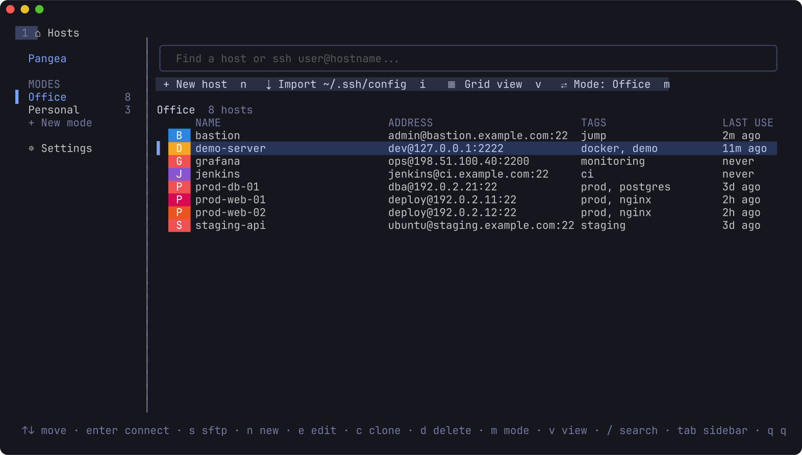
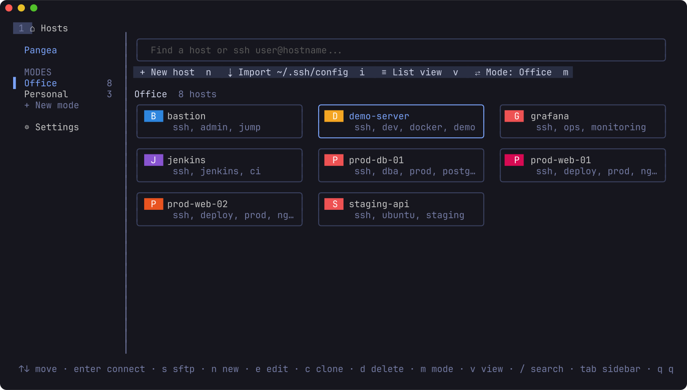
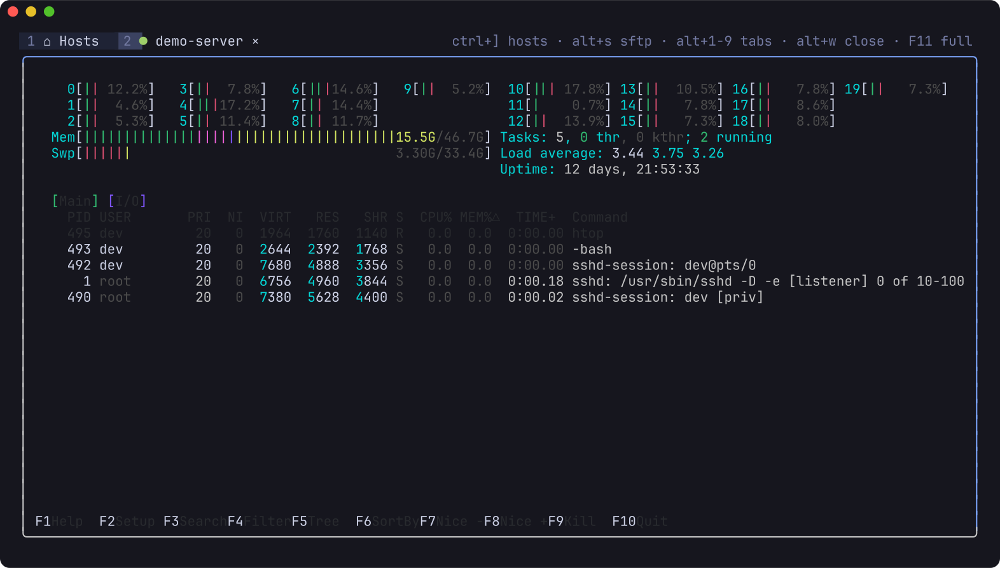
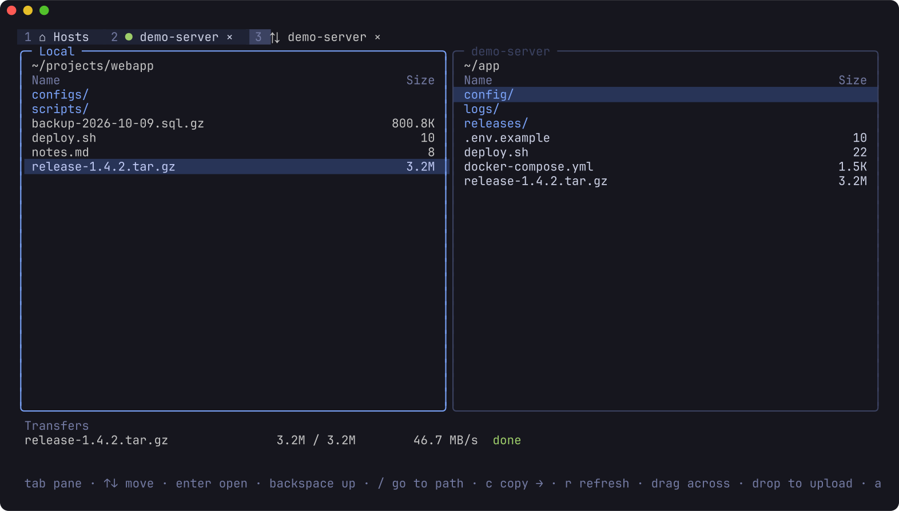
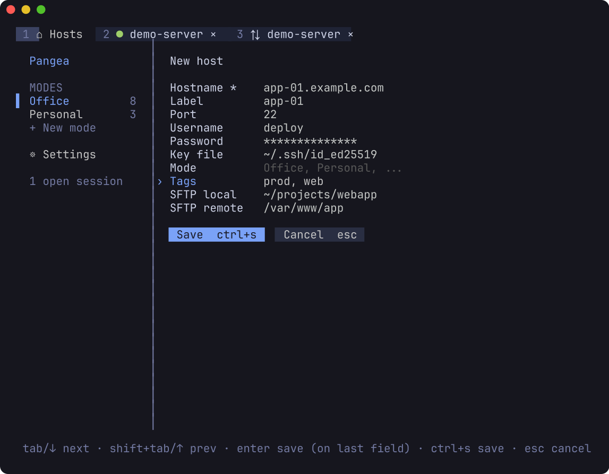
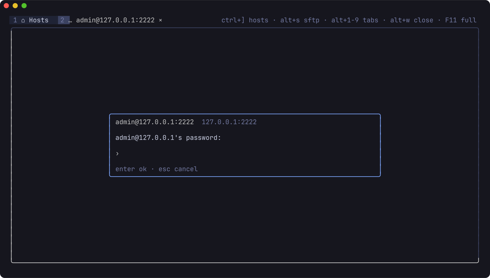
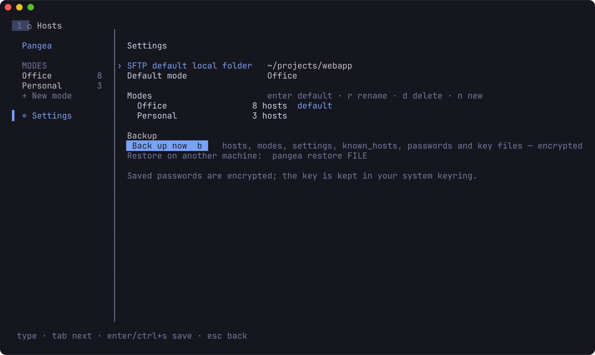

# Pangea

**One island for all your servers.** Pangea is a fast SSH and SFTP client that runs in your
terminal — hosts, sessions in tabs, file transfer, saved passwords and encrypted backups, all
keyboard- *and* mouse-friendly. A single small binary instead of a heavy desktop app.



## Why

Desktop SSH managers are comfortable but heavy (hundreds of MB of RAM, Electron) and often
subscription-based. Pangea keeps the comfort — host list, tabs, SFTP with drag & drop, saved
credentials — in a terminal UI:

| | Pangea |
|---|---|
| Idle memory, 3 tabs open | ~25 MB |
| Busy session with 10,000 lines of history | ~43 MB |
| Binary | one static file, ~8 MB |
| SFTP throughput (local test) | 2–3× faster upload than OpenSSH `sftp` |

## Features

**Hosts**
- **Modes** such as *Office* and *Personal* — each shows only its own hosts; switch with `m`,
  a click, or the sidebar
- **List** (default) or **grid** view, fuzzy search, last-used times
- Quick connect: type `user@host:port` in the search box
- Import from `~/.ssh/config` (read-only — your file is never changed)

**Terminal sessions in tabs**
- Each session is its own tab; background tabs light up when they print
- Full terminal emulation: vim, htop, tmux, mouse support inside apps
- Scrollback with the mouse wheel or `shift+PgUp/PgDn`
- `F11` fullscreen hands the session the whole terminal at native speed
- Reconnect in place with `enter` when a session ends

**SFTP**
- Two panes (local / remote); `alt+s` opens SFTP for the session you're in, reusing its login
- Drag a file between panes, or drop files from your file manager onto the window to upload
- Path bar with **Tab completion** (`/` to open), `~` works on both sides
- Per-host and default start folders
- Never overwrites an existing file

**Security & data**
- Host keys verified against `~/.ssh/known_hosts` and Pangea's own file; unknown keys are
  shown with their fingerprint, changed keys are refused
- Passwords saved **encrypted** (XChaCha20-Poly1305); the key lives in your OS keyring
  (KWallet / GNOME Keyring via Secret Service, Windows Credential Manager, macOS Keychain)
- The saved password is tried first; if it's wrong you're asked, and offered to save the new one
- **Backup** everything — hosts, modes, settings, known_hosts, passwords and key files — into
  one passphrase-encrypted file, and restore it on another machine

## Screenshots

| | |
|---|---|
|  |  |
| Grid view | A session in a tab (htop) |
|  |  |
| SFTP with a finished transfer | Adding a host |
|  |  |
| Password prompt | Settings, modes and backup |

## Install

Requires Go 1.26 or newer. Build from source (`go install …@latest` doesn't work because the
module uses `replace` directives for its forked terminal libraries):

```sh
git clone https://github.com/kannan983/pangea.git
cd pangea
go build -o pangea ./cmd/pangea
```

Cross-compile (pure Go, no C toolchain needed):

```sh
GOOS=windows GOARCH=amd64 go build -o pangea.exe ./cmd/pangea
GOOS=darwin  GOARCH=amd64 go build -o pangea-macos ./cmd/pangea
```

Linux is the tested platform; Windows and macOS builds compile but haven't been tested yet.

## Usage

```sh
pangea                  # start the UI
pangea backup FILE      # encrypted backup (asks for a passphrase)
pangea restore FILE     # restore; your current config is moved aside first
```

### Keys

**Everywhere**

| Key | Action |
|---|---|
| `alt+1` … `alt+9` | switch tab (1 = Hosts) |
| `ctrl+]` | back to Hosts |
| `alt+w` | close tab |
| `alt+s` | SFTP for the current session's host |
| `F11` | fullscreen session (F11 again to return) |

**Hosts**

| Key | Action |
|---|---|
| `↑↓←→` / `hjkl` | move |
| `enter` / double-click | connect |
| `s` | SFTP |
| `n` / `e` / `c` / `d` | new / edit / clone / delete host |
| `/` | search, or quick connect `user@host:port` |
| `m` / `M` | next mode / new mode |
| `v` | list ↔ grid |
| `i` | import `~/.ssh/config` |
| `tab` | move into the sidebar (modes, settings) |
| `q` | quit |

**SFTP**

| Key | Action |
|---|---|
| `tab` | switch pane |
| `enter` / `backspace` | open folder / go up |
| `/` | type a path (`tab` completes) |
| `c` | copy selection to the other pane |
| `r` | refresh |
| mouse | click, wheel, drag a file across; drop files from the desktop to upload |

**In a session:** every key goes to the server except the ones above. Select text with
`shift+drag` (your terminal's own selection).

## Where things are stored

| File | What |
|---|---|
| `~/.config/pangea/hosts.json` | hosts (no passwords) |
| `~/.config/pangea/settings.json` | modes, defaults |
| `~/.config/pangea/known_hosts` | host keys you trusted in Pangea |
| `~/.config/pangea/vault.bin` | saved passwords, encrypted |
| OS keyring, entry `pangea / vault-key` | the key that unlocks `vault.bin` |

On Windows the folder is `%AppData%\pangea`. If no OS keyring is available, the vault key is
kept in `vault.key` (owner-only permissions) and Pangea shows a warning.

## How it works

- UI: [Bubble Tea v2](https://github.com/charmbracelet/bubbletea) and Lip Gloss
- SSH: [`golang.org/x/crypto/ssh`](https://pkg.go.dev/golang.org/x/crypto/ssh) — in-process, so
  one login can carry the shell and SFTP
- SFTP: [`github.com/pkg/sftp`](https://github.com/pkg/sftp) with pipelined reads and writes
- Terminal emulation: a fork of [`charmbracelet/x/vt`](https://github.com/charmbracelet/x) and
  [`ultraviolet`](https://github.com/charmbracelet/ultraviolet) in `third_party/`, changed for
  speed and memory: O(1) scrollback, line rotation instead of cell copies when scrolling, and
  history stored as compact strings (≈200 MB → ≈40 MB on a 10,000-line flood).
  The diffs are in `spikes/patches/`.

## Development

```sh
go test ./...
```

`spikes/testenv` has a throwaway SSH server for testing:

```sh
cd spikes/testenv
ssh-keygen -t ed25519 -N '' -f id_ed25519   # test-only key, git-ignored
docker compose up -d --build                 # listens on 127.0.0.1:2222, user "dev"
```

`spikes/` also holds the original feasibility prototypes.

## Roadmap

- Jump hosts (ProxyJump)
- Port forwarding (local, remote, SOCKS), saved per host
- Snippets and command history with a fuzzy palette, run on many hosts at once
- A scriptable/agent-friendly CLI (`pangea hosts ls --json`, `pangea exec`)
- Split panes
- Tested Windows and macOS builds, ARM builds

## Acknowledgements

Built on the excellent work of [Charm](https://charm.land), the Go team's `x/crypto`, and
`pkg/sftp`. Inspired by Termius.
